# Comanda · por Varthex

A identidade **Comanda · por Varthex** aparece na abertura, área de trabalho, ajuda e rodapé. [Logos e recursos da marca](brand/comanda-varthex/README.md).

Sistema Windows para organizar mesas, comandas e consumo em pequenos estabelecimentos de alimentação. Produtos, atendimento, fechamento e histórico funcionam localmente, sem depender da internet.

**Release 1.4.0 atualizada em 23/10/2026 · versão em testes.** Edições normal e demonstração recompiladas com pagamentos parciais e mistos, divisão por itens, novos avisos de início e renovação. Ambas incluem o .NET e exigem ativação offline.

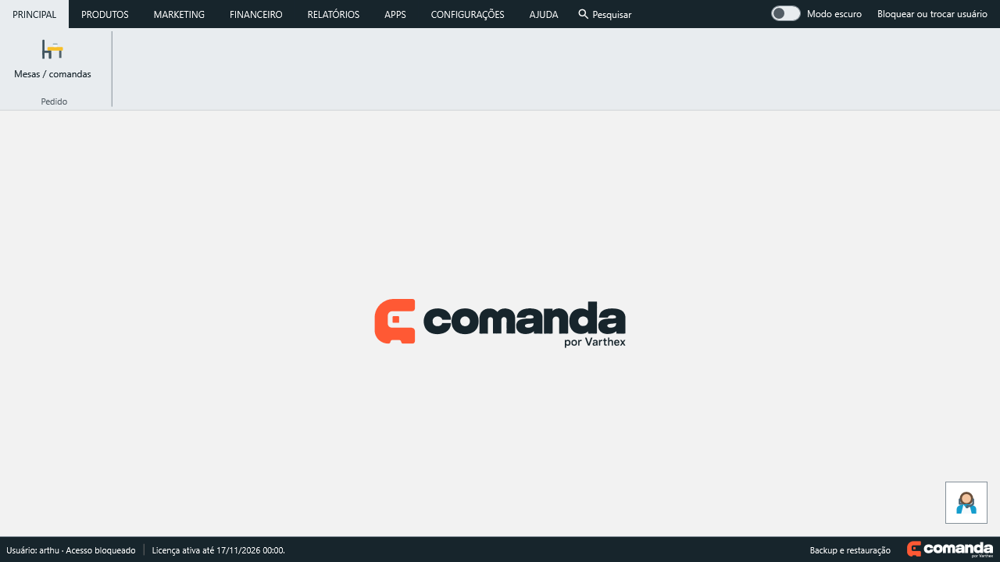

## Baixar para Windows

| Edição 1.4.0 | Para quem | Download |
| --- | --- | --- |
| **Normal — sem demonstração** | Cadastrar os produtos reais do estabelecimento; catálogo vazio em uma instalação nova | [Baixar instalador Windows x64](https://github.com/arthurtvrs10/Comanda/releases/download/v1.4.0/VarthexComanda-1.4.0-Setup-win-x64.exe) · [SHA-256](downloads/windows/VarthexComanda-1.4.0-Setup-win-x64.exe.sha256) |
| **Demonstração** | Conhecer o sistema com 12 produtos fictícios e fotos; sem comandas abertas em uma base nova | [Baixar instalador Windows x64](https://github.com/arthurtvrs10/Comanda/releases/download/v1.4.0/VarthexComanda-Demo-1.4.0-Setup-win-x64.exe) · [SHA-256](downloads/demo/VarthexComanda-Demo-1.4.0-Setup-win-x64.exe.sha256) |

[Notas da release 1.4.0](https://github.com/arthurtvrs10/Comanda/releases/tag/v1.4.0) · [Instalação normal](downloads/windows/README.md) · [Instalação da demonstração](downloads/demo/README.md)

Instalação por usuário, sem administrador, em Windows x64. Feche o aplicativo antes de atualizar. Reinstalar ou atualizar preserva os dados e a licença existentes. Os instaladores não possuem assinatura de código.

A release é uma **pré-release**: instalação em Windows limpo e autorização/envio com uma conta Google real continuam pendentes. A [versão estável anterior 1.2.2](https://github.com/arthurtvrs10/Comanda/releases/tag/v1.2.2) permanece disponível.

## Em desenvolvimento — Principal e atendimento pelo celular

Principal reúne Mesas / comandas, Produtos, os dois históricos e Painel de senhas. COZINHA (KDS) é uma categoria própria; Configurações e Ajuda permanecem. As antigas categorias Produtos, Marketing, Financeiro, Relatórios e Apps foram removidas da navegação.

O primeiro servidor local permite ao garçom abrir comandas e lançar produtos pelo navegador na mesma rede. No desktop: **Configurações → Servidor / acesso pelo celular → Iniciar servidor**. Selecione o IP da rede e leia o QR Code no celular. Informe seu nome antes de lançar itens; quantidade e observação seguem as regras de UN/KG/L. Cobrança e fechamento ficam no computador. Pare o servidor antes de restaurar backups.

No celular, abrir uma comanda mostra seus itens, observações e total. **+ Produtos** abre uma tela separada com busca, categorias e cartões com as mesmas fotos cadastradas no desktop. Toque no cartão para ajustar quantidade/observações e confirmar; o sistema retorna à comanda atualizada. Produtos sem imagem mostram um substituto neutro. [Fluxo e validação](specs/2026-10-23-web-comanda-catalogo-fotos.md).

**Cozinha (KDS) no desktop:** cartões por comanda/mesa, observações, estados Pendente → Em preparo → Pronto → Entregue, ações por item e pelo conjunto exibido, filtros de local/situação e aviso sonoro opcional. Atualiza a cada três segundos; atenção após 10 minutos e atraso após 20. Entrega e cobrança são independentes. [Fluxo, migração e validação](specs/2026-10-23-cozinha-kds-desktop.md).

Esta etapa ainda não integra os instaladores publicados. Ensaio de Wi-Fi/firewall e revisão visual em navegador/celular físico permanecem pendentes. [Contrato e limites](specs/2026-10-23-principal-servidor-local.md) · [Decisão arquitetural](docs/docs/adr/0006-servidor-local-atendimento-movel.md).

## Novidades da 1.4.0

- **Pagamento por etapas:** selecione dinheiro, Pix, débito ou crédito, informe o valor na janela de lançamento e confirme o recebimento. Registros parciais e mistos ficam salvos; resumo com valor pago, recebido, troco em dinheiro, saldo e progresso. Finalize ou finalize e imprima após quitar a conta.
- **Conferir e rachar a conta:** toggle à esquerda revela os itens e a divisão igual por pessoas. A seleção de itens calcula o pagamento e identifica as linhas já pagas; cada seleção inclui toda a quantidade da linha.
- **Drive após o login:** convite uma vez por abertura quando não conectado. Adiar mantém a conexão manual em Backup → Google Drive; bloquear/desbloquear não repete o convite.
- **Renovação por WhatsApp:** aviso nos últimos sete dias da licença, com destaque vermelho e botão verde. A renovação é combinada com o suporte, e a nova chave é inserida na ativação.
- **Demonstração pronta para começar:** catálogo de exemplo sem pedidos, comandas ou vendas pré-abertas. Os dados reais ficam separados.

- **Configurações redesenhadas:** navegação com ícones, toggles com estado visível, campos agrupados e aviso de alterações reais. A quantidade de comandas fica em Numeração de pedidos.
- **Acesso opcional:** instalações novas abrem na área inicial, sem senha e sem abrir comandas automaticamente. Todos os usuários têm acesso às áreas nesta versão.
- **Proteção por senha:** ao ligar o toggle em Segurança, crie e confirme a senha de acesso e uma senha de recuperação diferente (mínimo de 4 caracteres). Salve as alterações para aplicar. Login inicial: `gestor`.
- **Bloqueio e recuperação:** com proteção ativa, o login aparece ao iniciar e bloquear. Campos centralizados, placeholders, toggle Mostrar senha e sistema desfocado ao fundo. Esqueci minha senha permite definir uma nova senha de acesso usando a senha de recuperação, sem internet.
- **Impressos térmicos:** conta, cozinha, reimpressão, fichas e teste de impressora com papel de 58 ou 80 mm, conforme a impressora configurada.

- **Área de trabalho com janelas internas:** abra, mova, redimensione, maximize e organize os módulos abaixo da Ribbon. A antiga tela de seleção de perfis foi removida.
- **Abertura com a marca:** arte abstrata, logo central, versão e indicação de carregamento. Permanece por pelo menos 5 segundos antes de apresentar a tela principal.
- **Modo escuro por toggle:** ative ou desative no cabeçalho; a preferência fica salva neste computador. Fundo padrão com logo central: cinza no claro e azul profundo no escuro, preservando imagens e cores personalizadas. Controles com superfícies neutras nos dois temas.
- **Mesas e comandas:** observações, responsável, prioridades por cor, transferência/cópia de itens e indicação amarela de **Em fechamento**. Numeração inicial configurável.
- **Catálogo e lançamento:** produtos com fotos ou em lista, filtro por categoria, ordenação visível e personalização de quantidade e observações. Venda por **UN, KG ou L**, com até três casas decimais para KG/L.
- **Backup com progresso:** janela própria, barra e mensagens da execução, restauração de dados e fotos, Google Drive por OAuth preparado e OneDrive por pasta sincronizada.
- **Ajuda:** painel compacto ao lado do atalho, WhatsApp, RustDesk, sugestões e tutorial guiado. A central de ajuda está em preparação.
- **Relatórios:** Histórico de pedidos e Histórico de vendas reunidos no grupo Vendas da versão publicada; no desenvolvimento, ambos estão em Principal. Pesquisa, colunas, ordenação, exportação Excel e prévia de impressão; detalhes preservam os registros originais.

## Recursos

| Área | O que oferece |
| --- | --- |
| Produtos | Categorias, preço de custo e venda, fotos, unidades de venda e ativação/desativação |
| Atendimento | Mesas opcionais, comandas numeradas, cliente opcional, itens, quantidades, observações e total |
| Fechamento | Recebimentos manuais parciais/mistos, divisão por pessoas ou itens, saldo, troco em dinheiro e finalização com impressão |
| Relatórios | Históricos de pedidos e vendas, filtros, colunas, detalhes, Excel, impressão e resumo diário |
| Continuidade | Backup automático/manual local, checksum, restauração, recuperação de comandas e logs |
| Acesso | Senha opcional, login de gestor/colaboradores, senha de recuperação offline e licença vinculada ao computador |

A cobrança é realizada fora do sistema; não há integração com maquininha, emissão fiscal, estoque completo ou atendimento em rede nos instaladores publicados. Nesses instaladores, a cozinha é uma consulta local de comandas abertas; o KDS com preparo descrito acima está em desenvolvimento. Pedidos independentes e evolução do atendimento continuam no [plano](docs/docs/21-evolucao-atendimento.md).

## Instalar e começar

1. Escolha a edição normal ou demonstração e execute o instalador.
2. Ative o aplicativo com a licença fornecida pelo responsável.
3. A instalação nova abre sem senha. Na edição normal, cadastre categorias e produtos; a demonstração já traz o catálogo fictício. Se a proteção estiver ativada, entre com seu login e senha.
4. Abra **Principal → Mesas / comandas**, selecione o número e lance os produtos.
5. Confira o total e realize a cobrança externamente. Em Pagamento, selecione a forma, registre cada recebimento e finalize quando o saldo estiver quitado.

A edição normal usa `%LOCALAPPDATA%\VarthexComanda` e a demonstração usa `%LOCALAPPDATA%\VarthexComandaDemo`. Os atalhos e instalações são separados; a demonstração abre pelo atalho **Comanda Demonstração**. O catálogo fictício é carregado somente na primeira base vazia e não substitui alterações posteriores.

Para ativar a senha: **Configurações → Configurações do sistema → Segurança → Ativar proteção por senha**. O toggle abre o cadastro; cancelar mantém a proteção desativada. Guarde a senha de recuperação separadamente. Quem já tem credenciais pode configurar ou alterar a recuperação em **Segurança → Senha de recuperação**, confirmando a senha de acesso atual. Não há senha mestra universal, recuperação por e-mail ou chave Resend nesta versão.

A proteção é local e não substitui o controle de acesso do Windows. Atualizações preservam a preferência existente; desative o toggle e salve caso queira acesso livre. Enquanto houver alterações pendentes, salve antes de gerenciar as senhas.

Em **Configurações → Backup e restauração**, escolha a pasta local e faça uma cópia. O Google Drive exige cadastrar/importar um cliente OAuth de aplicativo para computador; nenhuma credencial acompanha o instalador. O convite aparece uma vez por abertura, depois do login, e pode ser adiado após cinco segundos; para conectar mais tarde, abra Backup → Google Drive. O OneDrive usa a pasta sincronizada pelo aplicativo instalado no Windows. O backup local continua disponível sem conexão.

[Operação e recuperação](docs/docs/12-operacao-implantacao.md) · [Licenciamento](docs/docs/20-licenciamento-offline.md) · [Configurar Google Drive](docs/docs/22-configuracao-google-drive.md)

## Pagamento e renovação

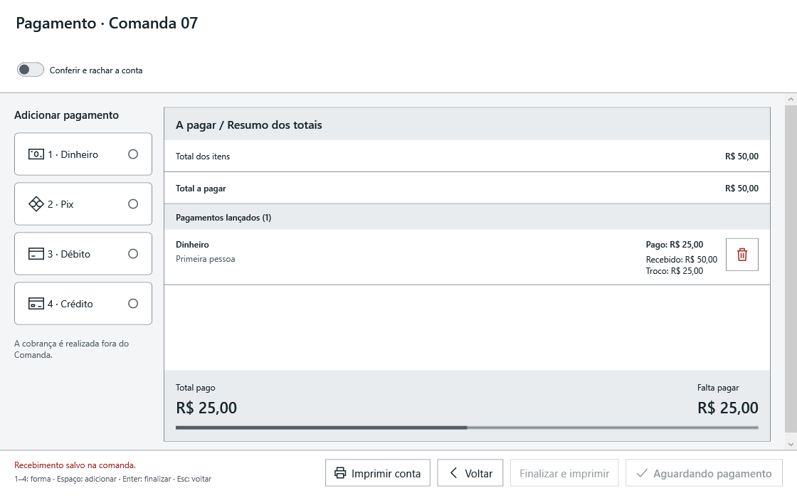

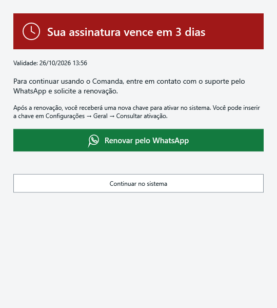

Recebimentos são registros manuais da cobrança externa, sem integração bancária. Remover um lançamento não faz estorno. Enquanto houver recebimentos ativos, alterações dos itens e cancelamento da comanda ficam bloqueados. Não há fiado, taxas/descontos ou dados de maquininha nesta entrega.

A atualização adiciona a migração de recebimentos à comanda e à venda. Mantenha o backup antes de atualizar; o sistema preserva uma cópia antes de migrar.

## Configurações e acesso

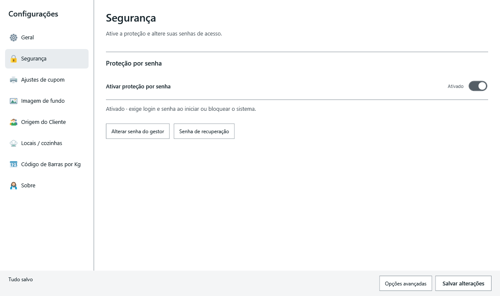

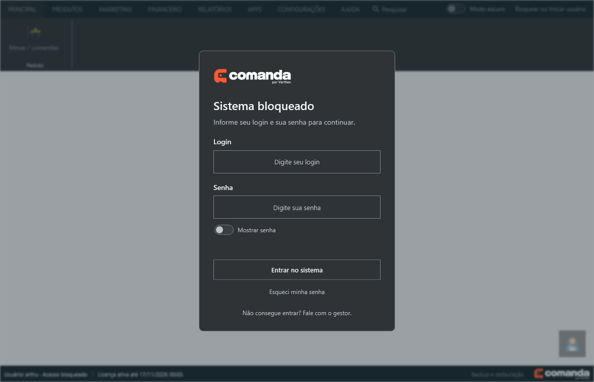

## Telas da release

Capturas da interface WPF desta atualização, geradas com dados fictícios de teste. Não contêm registros de clientes.

**Tela de abertura**

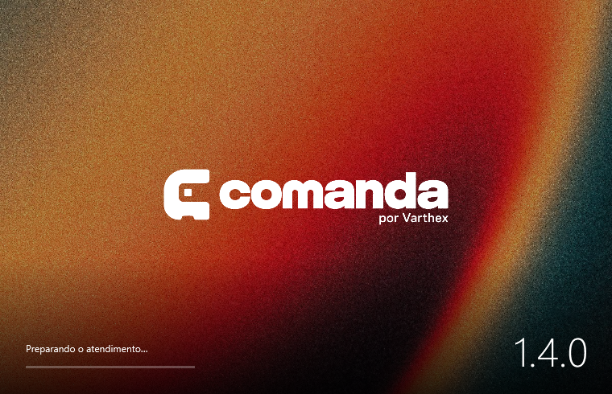

**Modo escuro e toggle ativado**

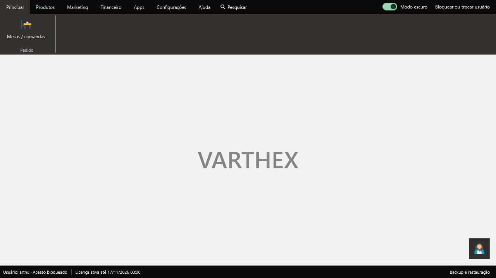

**Grade de comandas**

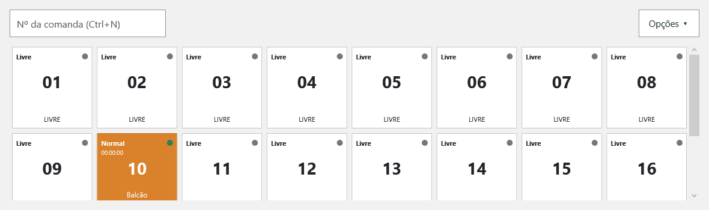

**Consumo e fechamento**

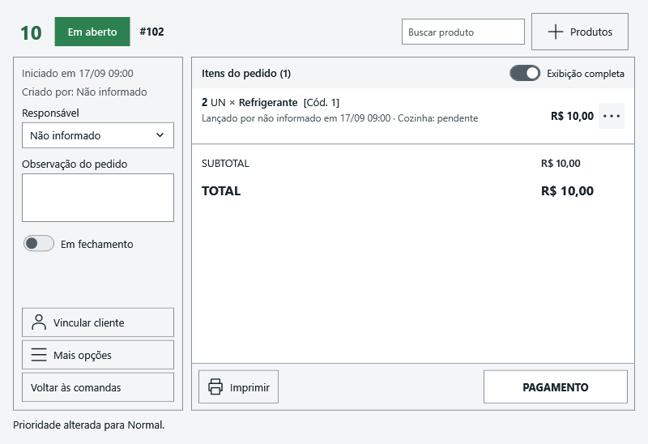

**Produtos em janela interna**

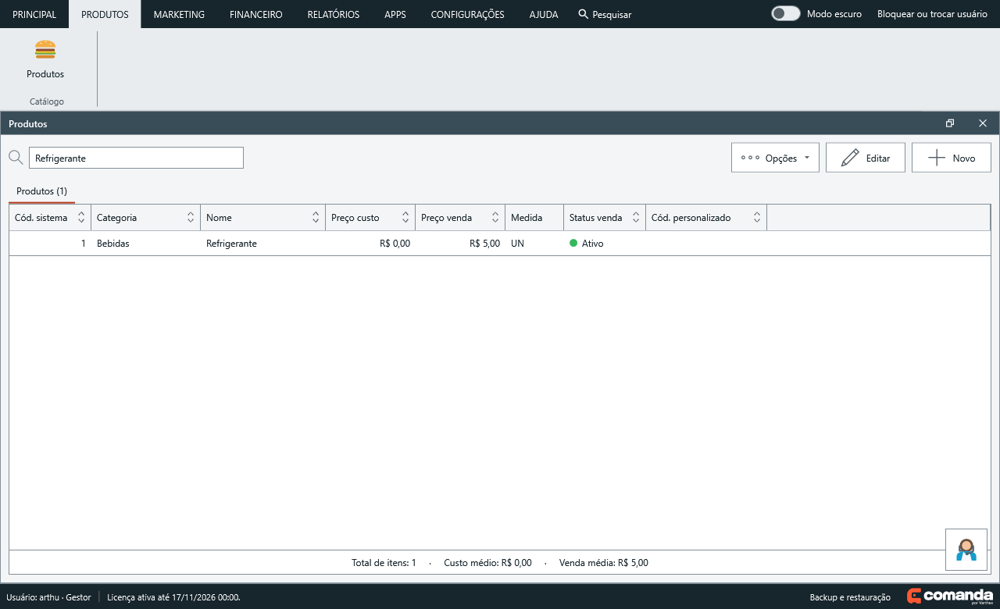

**Histórico de vendas**

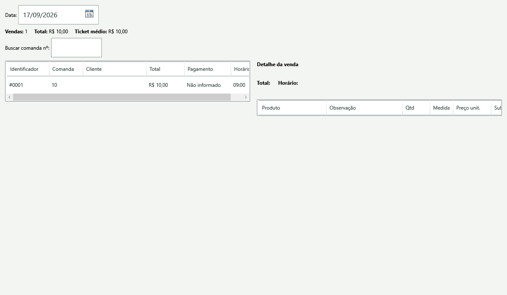

**Histórico de pedidos**

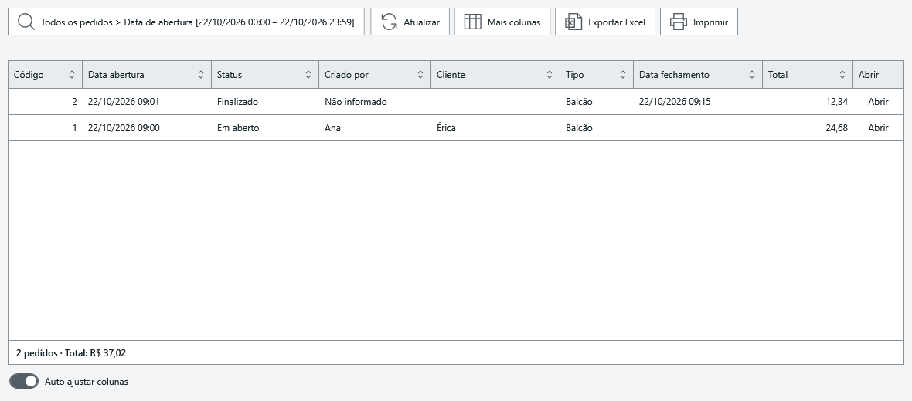

## Android — gerador de licenças

O aplicativo Android é exclusivo do responsável pela emissão de licenças; não é um aplicativo de atendimento. A chave privada do emissor não acompanha os pacotes e não deve ser compartilhada com clientes.

[Downloads e instruções do emissor](mobile/licencas/README.md) · [Arquivos Android](downloads/android/README.md)

## Desenvolvimento

Stack atual: **C# e .NET 10 LTS, WPF/MVVM, SQLite e Entity Framework Core**, com camadas Domain, Application, Infrastructure e Desktop.

No Windows, com SDK .NET 10:

```powershell
dotnet build backend/VarthexComanda.slnx
dotnet test backend/VarthexComanda.slnx --configuration Release
dotnet run --project backend/src/VarthexComanda.Desktop
```

Instalador normal: `scripts/gerar-instalador.ps1`. Demonstração: `scripts/gerar-demo.ps1`. Exigem Inno Setup 6. ZIP alternativo: `scripts/publicar.ps1`.

Distribua somente os pacotes preparados. A pasta `artifacts` pode conter material privado do emissor e não deve ser publicada inteira. JSON OAuth, tokens Google e chaves privadas ficam fora do Git e dos instaladores.

## Documentação e validação

Esta atualização da 1.4.0 inclui os dois históricos em **Relatórios → Vendas** e a tela de abertura com duração mínima de 5 segundos. Os instaladores e os arquivos SHA-256 foram substituídos juntos; quem baixou a compilação anterior deve baixar novamente.

Validação: **770 testes distintos aprovados em Release** (4 Domain, 133 Application, 303 Infrastructure e 330 Desktop). Instalação em Windows limpo, impressão física e OAuth com conta Google real permanecem pendentes.

- [Índice completo](docs/README.md)
- [Notas e evidências da 1.4.0](specs/2026-10-22-release-1.4.0.md)
- [Atualização da 1.4.0, capturas e novos pacotes](specs/2026-10-22-atualizacao-release-1.4.0.md)
- [Abertura do sistema](specs/2026-10-22-tela-abertura.md)
- [Histórico de alterações](docs/CHANGELOG.md)
- [Drive, medidas e migração](specs/2026-10-22-drive-oauth-medidas-venda.md)
- [Plano de evolução](docs/docs/21-evolucao-atendimento.md)
- [Homologação](docs/homologacao/README.md)

Testes automatizados e capturas locais não substituem homologação no estabelecimento, instalação em Windows limpo ou ensaio de autorização e backup com conta Google real.

## Licença do código

Nenhuma licença de uso do código foi definida. A licença comercial de ativação do aplicativo é um assunto separado.
