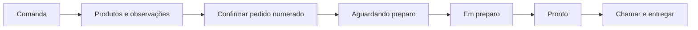
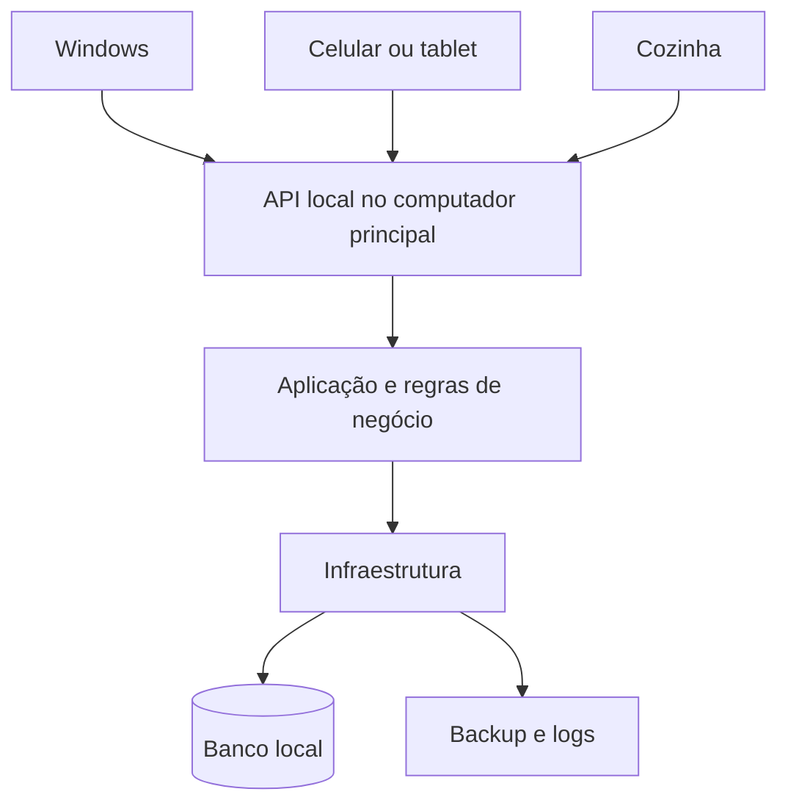

# Varthex Comanda

Sistema para pequenos estabelecimentos de alimentação. Registra consumo em comandas, calcula o total e mantém histórico local. Funciona em um computador Windows, sem internet.

**Situação:** produto atual disponível; evolução local descrita abaixo. Pedido independente, preparo e rede local permanecem em planejamento.

## Reconstrução funcional — evolução local de 19/10/2026

O código em desenvolvimento amplia o fluxo existente de produtos → comanda → consumo → fechamento:

- Mesa opcional de 1 a 999, com indicação de balcão quando não informada. Para definir ou alterar, abra a comanda e use o botão de mesa abaixo do cabeçalho.
- Comandas da mesma mesa continuam independentes e podem ser encerradas separadamente.
- Observação de até 300 caracteres para o próximo produto adicionado. O campo é limpo após a gravação; instruções diferentes mantêm linhas separadas.
- Mesa e instruções aparecem na consulta da cozinha; observações também aparecem no histórico.
- Atualização do banco por nova migração, aproveitando o backup preventivo existente.

Essas alterações ainda não fazem parte dos instaladores publicados abaixo. Não houve importação do banco ou do código do Consumer. Pedido numerado independente e estados de preparo continuam planejados.

[Escopo e validação desta entrega](specs/2026-10-19-reconstrucao-funcional.md).

## Recursos atuais

| Área | Função |
| --- | --- |
| Produtos | Categorias, preços, fotos opcionais e desativação |
| Atendimento | Comandas numeradas, nome opcional do cliente, itens, quantidades e total |
| Encerramento | Confirmação do operador após cobrança realizada fora do sistema |
| Histórico | Consulta de vendas e resumo diário |
| Continuidade | Backup, restauração, recuperação de comandas e logs |
| Licenciamento | Ativação offline vinculada ao computador |

Não há pagamento integrado, emissão fiscal, cozinha conectada ou atendimento móvel nas versões abaixo. O APK Android é exclusivo para gerar licenças.

## Windows — versão normal 1.2.2

[](https://github.com/arthurtvrs10/Varthex-Orders/releases/download/v1.2.2/VarthexComanda-1.2.2-Setup-win-x64.exe)

O download principal é o **Varthex Comanda para Windows 64 bits**, versão normal,
**sem produtos pré-cadastrados e sem modo de demonstração**. Em uma instalação nova,
o catálogo começa vazio para você cadastrar os produtos reais do estabelecimento.

Instala para o usuário atual, sem administrador, e inclui o .NET. Funciona offline
e requer ativação. Atualizar ou reinstalar preserva os produtos e a licença já existentes.
Os dados ficam em `%LOCALAPPDATA%\VarthexComanda`.

[Instruções](downloads/windows/README.md) · [SHA-256](downloads/windows/VarthexComanda-1.2.2-Setup-win-x64.exe.sha256)

## Windows — versão demonstração 1.2.3

[](https://github.com/arthurtvrs10/Varthex-Orders/releases/download/v1.2.3-demo/VarthexComanda-Demo-1.2.3-Setup-win-x64.exe)

Versão para conhecer o sistema, com **12 produtos de teste, fotos e preços fictícios**:
pastéis, salgados, porção e bebidas. Instala separadamente da versão normal e requer ativação.
Abra pelo atalho **Comanda Demonstração**. Os dados ficam em
`%LOCALAPPDATA%\VarthexComandaDemo`; reinstalar preserva as alterações.

[Instruções](downloads/demo/README.md) · [SHA-256](downloads/demo/VarthexComanda-Demo-1.2.3-Setup-win-x64.exe.sha256)

## Android — gerador de chaves

[](https://github.com/arthurtvrs10/Varthex-Orders/releases/download/android-v1.0.1/Varthex-Licencas-1.0.1.apk)

O botão baixa o APK **Varthex Licenças 1.0.1**.

Aplicativo para **Android 8.0 ou superior**, exclusivo do responsável pelas licenças.
Gera chaves offline de **1, 2, 3 meses ou vitalícias**, com opções para copiar e compartilhar.

1. Baixe o APK no celular, abra o arquivo e permita a instalação quando solicitado pelo Android.
2. Toque em **Colar chave privada** e cole o conteúdo completo do PEM, ou importe o arquivo `.pem` do emissor original.
3. Informe o cliente, cole o código do computador e escolha o plano e a data inicial.
4. Confirme a autorização e toque em **Gerar chave de ativação**. Envie somente a licença gerada ao cliente.

A chave privada não está incluída no APK e não deve ser compartilhada com clientes.
A compatibilidade das licenças com o Windows foi validada; a instalação e a interface ainda precisam ser conferidas em um aparelho Android.

[Instruções completas](mobile/licencas/README.md) · [Verificar integridade (SHA-256)](downloads/android/Varthex-Licencas-1.0.1.apk.sha256)


## Instalar e usar

1. Escolha a versão normal ou demonstração acima e execute o instalador.
2. Ative com a licença fornecida pelo responsável.
3. Cadastre produtos na versão normal; a demonstração traz produtos fictícios.
4. Abra uma comanda, informe o nome opcional e registre o consumo.
5. Confira o total, realize a cobrança fora do sistema e confirme o encerramento.

Atualizar ou reinstalar preserva os dados existentes. O instalador inclui .NET e instala por usuário. Não possui assinatura de código; pode haver aviso do Windows.

Dados normais: `%LOCALAPPDATA%\VarthexComanda`. Demonstração: `%LOCALAPPDATA%\VarthexComandaDemo`. Mantenha backup externo e valide a restauração antes de depender dele.

[Operação e recuperação](docs/docs/12-operacao-implantacao.md) · [Licenciamento](docs/docs/20-licenciamento-offline.md)

## Evolução planejada

| Ordem | Entrega |
| --- | --- |
| P1 | Pedido numerado dentro da comanda, observações e confirmação |
| P2 | Preparo, pronto, chamada verbal e entrega no Windows |
| P3 | Servidor local, atendimento móvel e tela da cozinha |
| P4 | Adicionais, impressão, mesas, permissões e gestão conforme o piloto |
| P5 | Pagamentos, fiscal, SmartPOS e integrações validadas |

Uma comanda poderá conter vários pedidos. Entregar um pedido não encerrará a comanda automaticamente. Regras ainda abertas estão registradas antes da implementação.



[Requisitos, aceitação e decisões abertas](docs/docs/21-evolucao-atendimento.md) · [Roadmap](docs/docs/11-roadmap-riscos.md)

## Arquitetura

Atual: **C# e .NET 10 LTS, WPF/MVVM, SQLite e Entity Framework Core**. Camadas: Domain, Application, Infrastructure e Desktop.

Planejada para P3:



Os dispositivos precisarão alcançar o servidor local. Sem resposta, o pedido não será mostrado como confirmado. Navegador ou app Android ainda será decidido.

[Arquitetura atual e futura](docs/docs/06-arquitetura.md)

## Telas atuais

Imagens de referência com dados fictícios. Não representam os recursos planejados de cozinha ou atendimento móvel.


[Identidade no Canva](https://www.canva.com/design/DAHWxyICQfE/IsxM-jV_WbNmWiN2n2sUjQ/edit)

## Desenvolvimento

No Windows, com SDK .NET 10:

```powershell
dotnet build backend/VarthexComanda.slnx
dotnet test backend/VarthexComanda.slnx --configuration Release
dotnet run --project backend/src/VarthexComanda.Desktop
```

Instalador normal: `scripts/gerar-instalador.ps1`. Demonstração: `scripts/gerar-demo.ps1`. Exigem Inno Setup 6. ZIP alternativo: `scripts/publicar.ps1`. APK: `mobile/licencas/build.ps1`.

Distribua somente os pacotes preparados. A pasta `artifacts` pode conter segredos do emissor.

## Documentação e validação

- [Índice completo](docs/README.md)
- [Escopo atual](docs/docs/01-escopo-mvp.md)
- [Requisitos atuais](docs/docs/02-requisitos.md)
- [Plano de evolução](docs/docs/21-evolucao-atendimento.md)
- [Homologação e evidências](docs/homologacao/README.md)
- [Histórico de alterações](docs/CHANGELOG.md)

Testes automatizados não substituem validação no estabelecimento. Instalação em Windows limpo, equipamento do piloto e interface Android precisam de evidência específica. Esta revisão documental não executou testes do aplicativo.

## Licença do código

Nenhuma licença de uso do código foi definida. A licença comercial de ativação do aplicativo é um assunto separado.

## Navegação Ribbon em desenvolvimento

A compilação local inclui categorias contextuais, pesquisa de funcionalidades/produtos e modos claro/escuro persistidos. Selecionar uma categoria mantém a tela atual; clicar em um comando abre o módulo existente. Grupos recolhem em menu em janelas menores. Os instaladores publicados ainda não incluem esta revisão.

[Mapeamento, uso e validação](specs/2026-10-20-ribbon-temas.md).

## Google Drive e medidas em desenvolvimento

A compilação local prepara conexão Google por OAuth no navegador e envio opcional
de backup, mantendo a cópia local; ainda exige configurar um projeto Google Cloud
e validar uma conta real. Ao entrar como gestor sem conexão, o convite permite
configurar depois após cinco segundos. OneDrive continua por pasta sincronizada.
Produtos aceitam UN, KG ou L, com até três casas decimais para KG/L e preservação
da medida nos itens históricos. Os instaladores publicados ainda não incluem
esta extensão. [Configurar Google Drive](docs/docs/22-configuracao-google-drive.md)
· [Contratos, migração e evidências](specs/2026-10-22-drive-oauth-medidas-venda.md).
