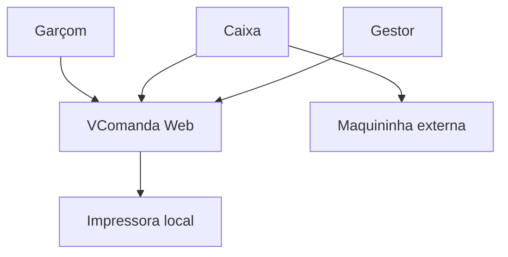
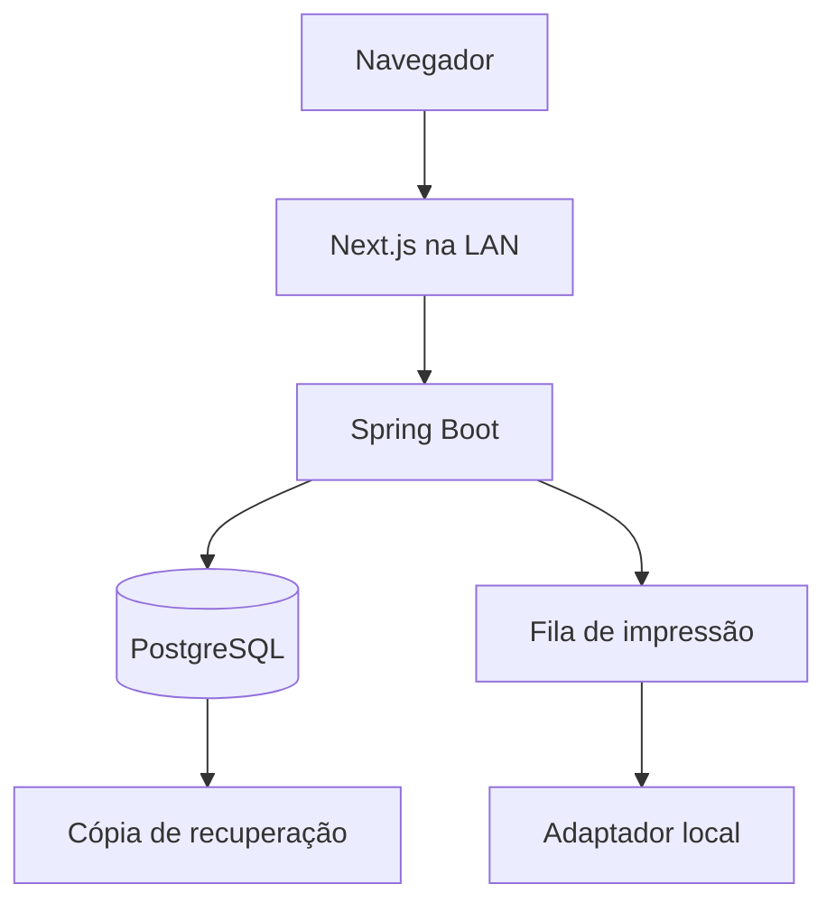
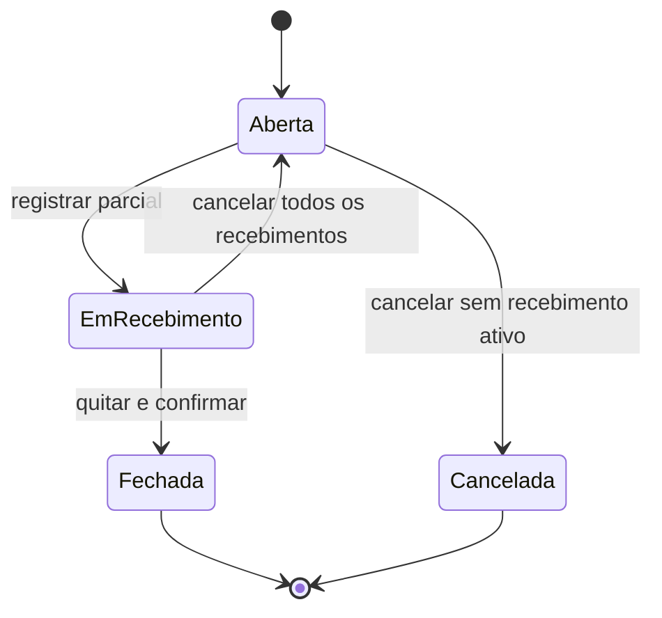
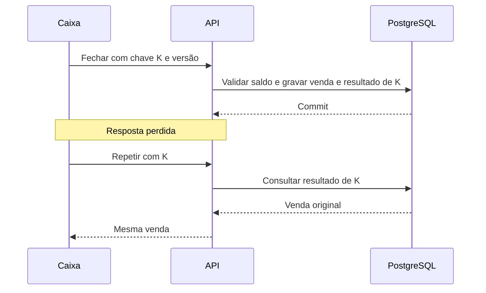
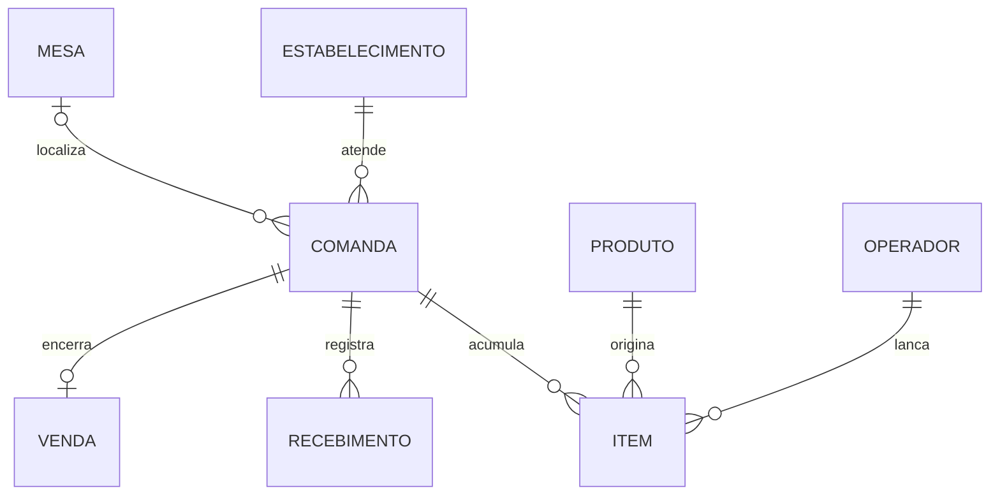

# Modelo proposto para o piloto
## Contexto

## Contêineres

## Estados

EmRecebimento é condição derivada na proposta web. O enum Windows contém Aberta, Fechada e Cancelada. Preserve o campo Bloqueada separadamente ao importar.
## Fechamento após perda de resposta

## Dados

IDs internos imutáveis. Índice único para número de comanda ativa por estabelecimento e para venda por comanda. Pessoa é identificador operacional da visita; nome opcional. Preço histórico em centavos e quantidade decimal por unidade. Relacionamentos devem respeitar estabelecimento. Versão aumenta em cada mutação. Resultado de idempotência persistido na transação com identidade do local, rota, chave e hash do pedido; chave igual com dados diferentes gera conflito.
