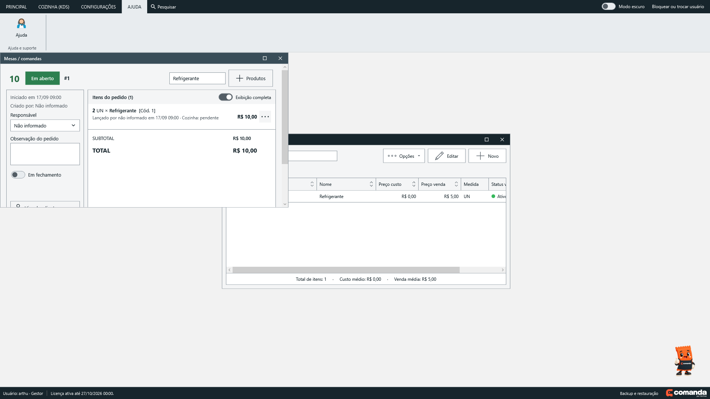
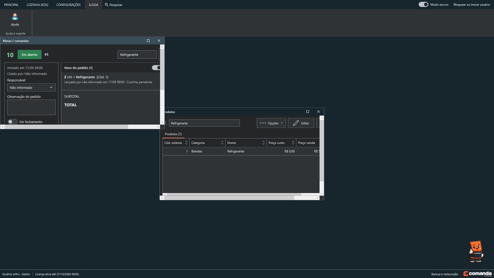
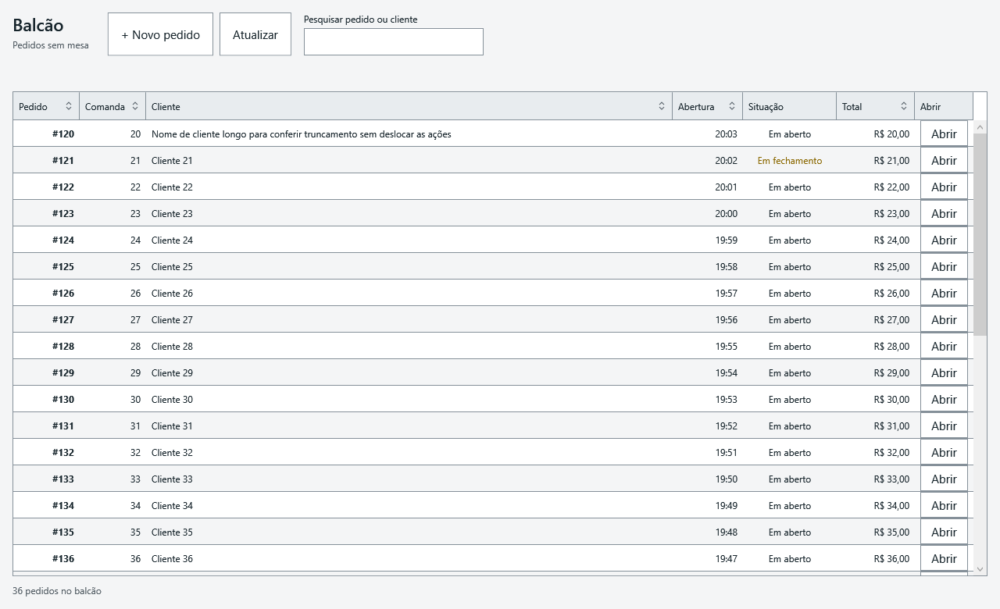
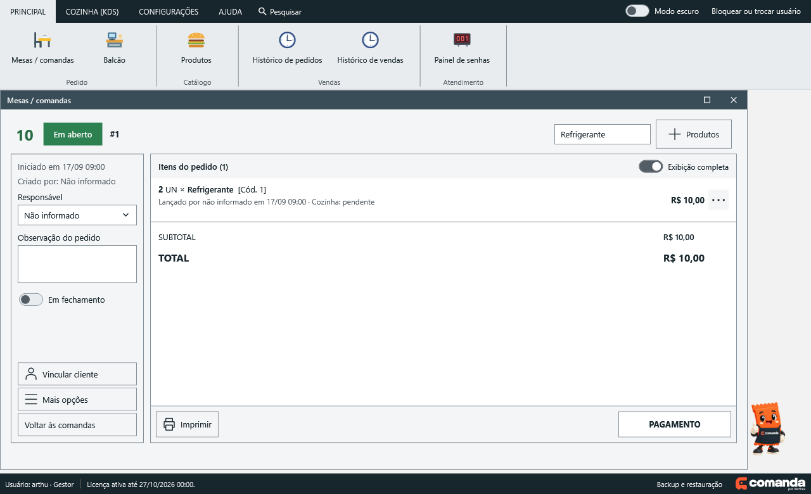
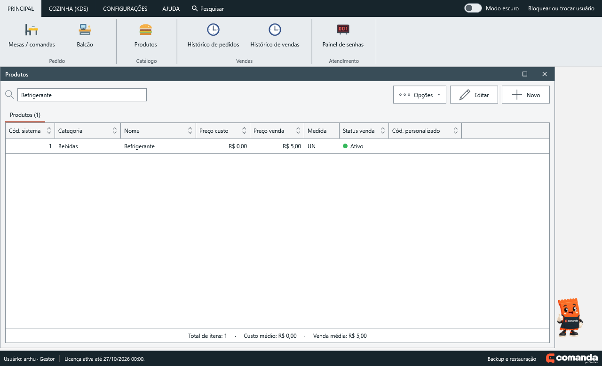
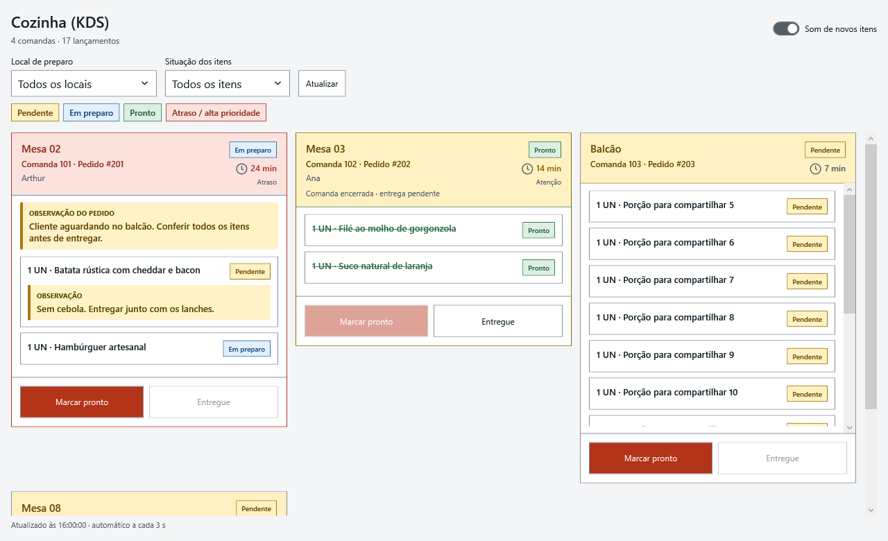
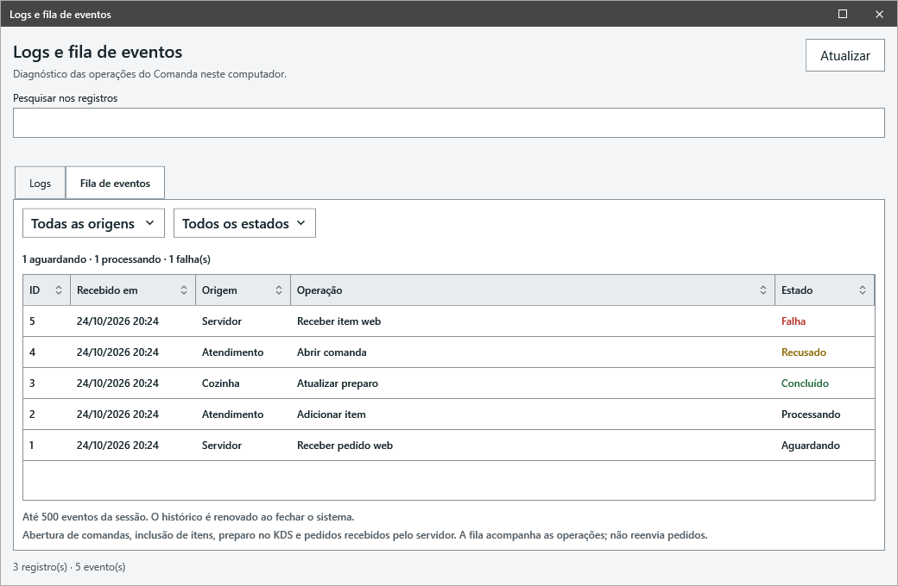

# Capturas do Comanda 1.4.2

Capturas WPF geradas em 24/10/2026 pela suíte desktop em Release, com dados fictícios. Os PNGs foram copiados diretamente das saídas de `VARTHEX_PREVIAS_TESTE`, sem edição ou geração por IA. Não mostram registros de clientes nem comprovam a fluidez do arraste com mouse físico.

| Tela | Captura | Origem do teste |
| --- | --- | --- |
| Janelas organizadas, claro | [PNG](janelas-claro.png) | `area-trabalho-organizada-claro.png` |
| Janelas organizadas, escuro | [PNG](janelas-escuro.png) | `area-trabalho-organizada-escuro.png` |
| Balcão | [PNG](balcao.png) | `balcao-claro-1280.png` |
| Atendimento | [PNG](atendimento.png) | `ribbon-atendimento-claro.png` |
| Produtos | [PNG](produtos.png) | `ribbon-expandida-claro.png` |
| Cozinha | [PNG](cozinha.png) | `kds-claro-1280.png` |
| Logs e fila de eventos | [PNG](logs-eventos.png) | `registros-claro-1040-1.png` |

