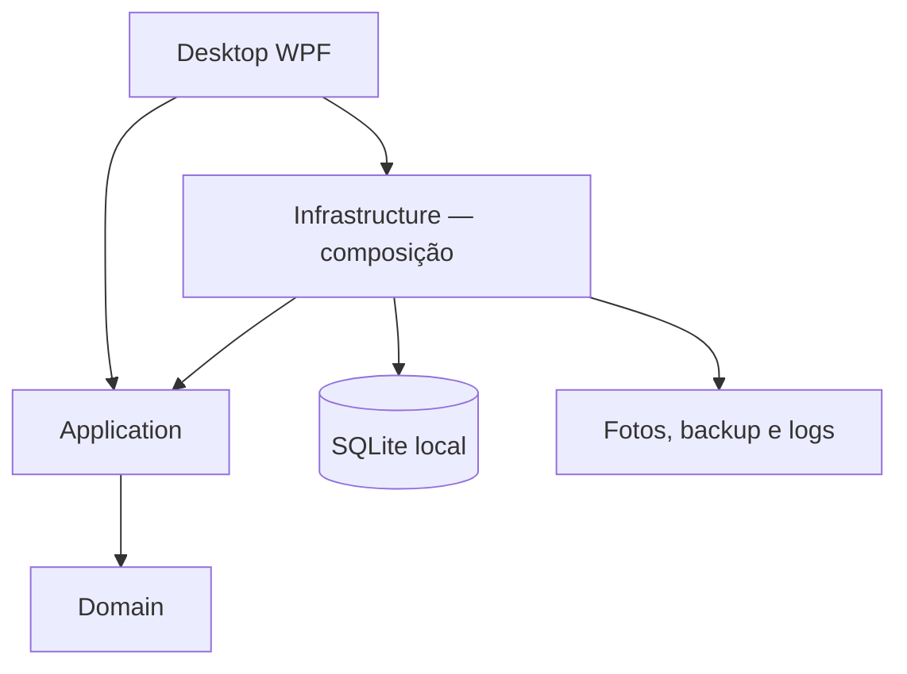
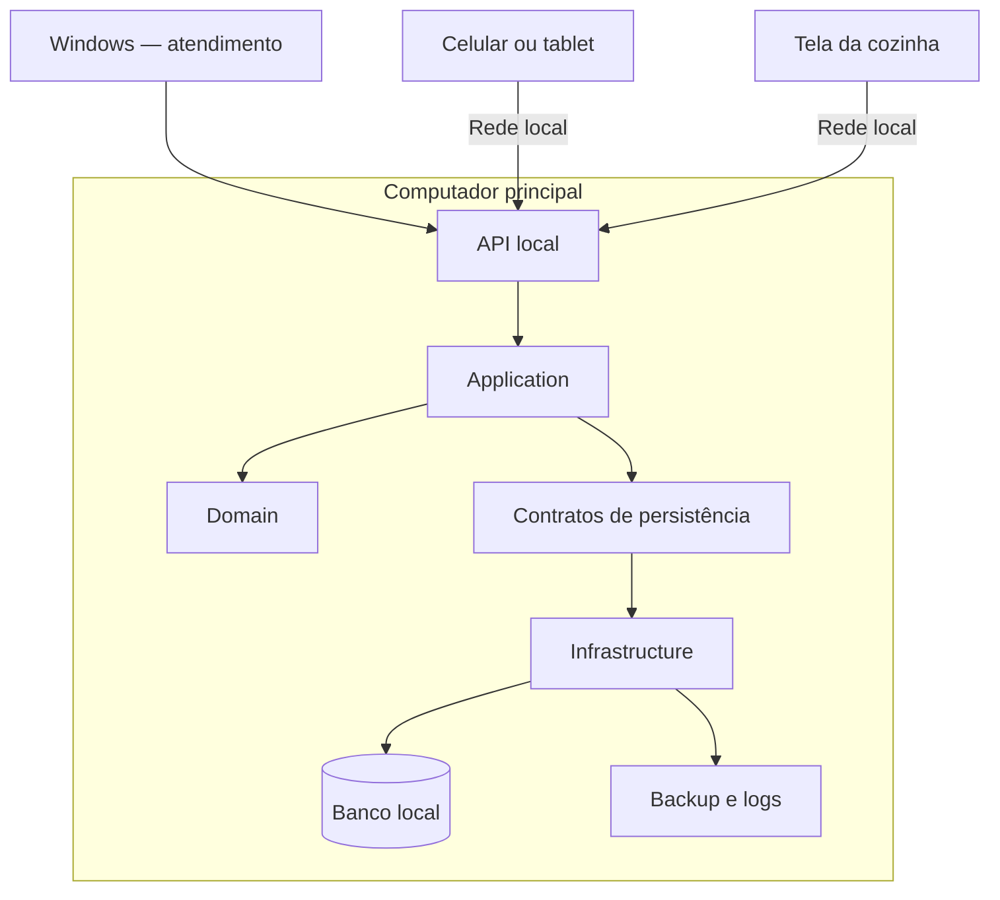

# Arquitetura
## Atual — implementada
C# e .NET 10 LTS, WPF/MVVM, Entity Framework Core e SQLite. Um computador Windows executa a interface e os casos de uso. Não há servidor operacional nem API local implementados.

| Projeto em backend/src | Responsabilidade |
| --- | --- |
| VarthexComanda.Domain | Entidades e regras de negócio |
| VarthexComanda.Application | Casos de uso e contratos |
| VarthexComanda.Infrastructure | Persistência, arquivos, relógio, logs e backup |
| VarthexComanda.Desktop | Interface WPF, ViewModels e composição |

Domínio e aplicação não dependem da interface. Infraestrutura implementa os contratos da aplicação. O banco evolui por migrações; esquema SQL documental é referência inicial.

## Evolução planejada — P3

Setas do segundo diagrama representam fluxo operacional; não prescrevem dependências de compilação.
- Servidor confirma somente após salvar; clientes não abrem o arquivo do banco.
- Internet não é necessária para a operação local; servidor e rede precisam estar disponíveis.
- Reenvio usa a mesma identificação para evitar duplicação.
- Autorização e proteção da comunicação devem ser definidas antes de P3.
- SQLite permanece no computador principal; adequação à concorrência será medida.
- Interface móvel por navegador ou Android nativo permanece em avaliação.
- Novos projetos são criados apenas quando a entrega exigir.
- API para distribuição automática de atualizações não está incluída em P3.

## Integridade
Abertura, alteração de consumo, encerramento e cancelamento devem ser atômicos.
Preservar backup antes de migração/restauração e impedir concorrência não suportada na edição atual.
A futura confirmação de pedido deverá preservar essas garantias.

## Decisões
- [ADR 0001 — Desktop local](adr/0001-aplicacao-desktop-local.md)
- [ADR 0002 — SQLite](adr/0002-sqlite.md)
- [ADR 0003 — Pagamento fora do MVP](adr/0003-pagamento-fora-mvp.md)
- [ADR 0004 — Windows e .NET](adr/0004-windows-dotnet-wpf.md)
- [ADR 0005 — Evolução por pedidos e API local](adr/0005-evolucao-pedidos-rede-local.md)
- [Requisitos e pendências da evolução](21-evolucao-atendimento.md)
