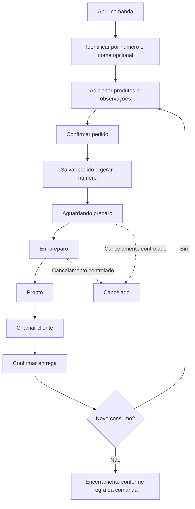

# Evolução do atendimento
Revisão: 05/10/2026. Status: planejamento de requisitos; nenhuma funcionalidade abaixo foi implementada nesta revisão.

## Objetivo e público
Atender pequenos estabelecimentos de alimentação, começando pelo balcão. Registrar o pedido, acompanhar o preparo e identificar a retirada. Varejo, eventos e múltiplas lojas ficam no banco de ideias.

## Situação e decisões
| Item | Situação |
| --- | --- |
| Catálogo, comandas, total, encerramento, histórico, backup e licença | Existentes; ver inventário abaixo |
| Comanda reúne o consumo; pedido reúne um envio para preparo | Direção planejada |
| Nome opcional e número visível | Nome já existe; número do pedido será novo |
| Preparo e entrega separados do encerramento da comanda | Direção planejada |
| Internet dispensável na operação local | Diretriz |
| Atendimento por navegador ou app Android | A decidir; APK atual é somente emissor de licenças |
| Pagamento, fiscal e SmartPOS | Futuro; sem fornecedor ou compatibilidade confirmados |

## Inventário do código
Leitura de estrutura e casos de uso; não equivale a homologação nem execução de testes em 05/10/2026.

| Capacidade | Situação | Evidência no repositório |
| --- | --- | --- |
| Produtos e categorias | Existente | Application/Catalogo |
| Comandas, itens, nome e encerramento | Existente | Application/Atendimento |
| Histórico | Existente | ListarVendasPorData e BuscarItensDaVenda |
| Backup e restauração | Existente | Application/Backup e Infrastructure/Backup |
| Licença offline | Existente | Application/Licenciamento; mobile/licencas |
| Rotação e limite de logs | Existente | Infrastructure/Logging/LoggingConfigurator.cs |
| Observação por item | Parcial | Campo no modelo; fluxo de edição para preparo ainda a especificar |
| Pedido independente e estados de preparo | Planejado | Sem entidade/caso de uso de pedido no núcleo consultado |
| API local, cozinha e atendimento móvel | Planejado | Projetos ainda não presentes |
| Homologação no estabelecimento | Pendente | docs/homologacao |

Os caminhos abreviados acima pertencem a `backend/src/VarthexComanda.*`.

## Fluxo planejado

Chamada inicial: verbal pelo número ou nome. Painel, som e impressão não fazem parte da primeira entrega. Cancelamento após pronto/entregue e encerramento antes da entrega dependem de QVE03/QVE04.

## Etapas
| Etapa | Entrega | Dependência | Saída para uso controlado |
| --- | --- | --- | --- |
| P1 | Pedido numerado, observações e confirmação dentro da comanda, no Windows | Resolver QVE01–QVE06 | Confirmar dois pedidos na mesma comanda sem duplicar consumo |
| P2 | Fila, preparo, pronto, chamada verbal e entrega no Windows | P1 | Acompanhar pedidos sem encerrar a comanda automaticamente |
| P3 | API local, atendimento móvel e tela da cozinha | P2 e decisões de rede/acesso | Dois dispositivos operam sem duplicação; falha de conexão fica visível |
| P4 | Adicionais, impressão, mesas, permissões e gestão | Necessidade do piloto | Escopo e aceite próprios por recurso |
| P5 | Pagamentos, fiscal, SmartPOS e integrações | Validação comercial e técnica | Piloto com fornecedor e equipamento definidos |

Permissões mínimas e identificação de dispositivos são pré-requisitos de P3; não ficam adiadas para P4. P4 amplia os perfis conforme a operação.

## Requisitos planejados
IDs EV não substituem os RF existentes. Todos estão planejados e não homologados.

| ID | Etapa | Requisito | Aceite |
| --- | --- | --- | --- |
| EV01 | P1 | Confirmar um conjunto de itens como pedido da comanda aberta | Pedido e itens salvos integralmente, ou nenhuma gravação |
| EV02 | P1 | Gerar número visível e identificador interno de pedido | Número permite localizar a retirada; política de reinício depende de QVE01 |
| EV03 | P1 | Informar observação por item | Observação reaparece no pedido; limite e equivalência dependem de QVE02 |
| EV04 | P1 | Criar novo pedido para novo consumo | Itens anteriores não são reenviados nem somados duas vezes |
| EV05 | P1 | Preservar pedidos confirmados e registrar correções | Sem exclusão silenciosa; política depende de QVE03 |
| EV06 | P2 | Controlar aguardando, em preparo, pronto e entregue | Transições persistidas e inválidas recusadas |
| EV07 | P2 | Localizar pedidos prontos por número e nome | Atendente consegue chamar verbalmente e confirmar entrega |
| EV08 | P2 | Separar entrega e encerramento | Entrega não gera venda nem encerra automaticamente |
| EV09 | P3 | Confirmar envio somente após persistência no servidor | Falha não mostra pedido como enviado |
| EV10 | P3 | Repetir uma solicitação sem duplicar pedido | Mesma identificação retorna o pedido já criado |
| EV11 | P3 | Informar indisponibilidade do servidor e preservar preenchimento | Não confirmar offline; retenção após fechar o aparelho depende de QVE08 |
| EV12 | P3 | Restringir acesso por operador/dispositivo autorizado | Cliente não acessa banco diretamente; acessos indevidos recusados |

## Regras planejadas
| ID | Regra |
| --- | --- |
| RE01 | Uma comanda pode ter vários pedidos; cada pedido pertence a uma única sessão de comanda |
| RE02 | Número reutilizável da comanda não é o identificador interno do pedido |
| RE03 | Preço e nome históricos são preservados; criar pedido não duplica o total da comanda |
| RE04 | Nova confirmação inclui somente o consumo ainda não confirmado |
| RE05 | Pedido confirmado não recebe alteração silenciosa; correção/cancelamento fica registrado |
| RE06 | Estado de preparo pertence ao pedido; situação financeira não pertence ao estado de preparo |
| RE07 | Somente persistência confirmada permite exibir sucesso |
| RE08 | Repetição da mesma solicitação não cria novo pedido |
| RE09 | Sem internet pode operar na rede local; sem servidor acessível não confirma novos pedidos |
| RE10 | Histórico anterior e comandas abertas devem ser preservados na atualização |

## Casos de uso planejados
| ID | Ator | Fluxo | Alternativa |
| --- | --- | --- | --- |
| UCE01 | Atendente | Abrir comanda → selecionar itens → informar observações → confirmar → receber número | Falha de gravação: informar erro e permitir nova tentativa sem duplicar |
| UCE02 | Atendente | Abrir mesma comanda → lançar novo consumo → confirmar outro pedido | Pedido anterior permanece inalterado |
| UCE03 | Operador de preparo | Consultar fila → iniciar → marcar pronto | Transição inválida recusada |
| UCE04 | Atendente | Localizar pronto → chamar cliente → confirmar entrega | Entrega não encerra comanda |
| UCE05 | Operador autorizado | Solicitar correção/cancelamento → registrar motivo → confirmar | Política de estados e efeito no total pendente em QVE03 |
| UCE06 | Atendente móvel | Enviar → aguardar confirmação → mostrar número salvo | Sem resposta: mostrar pendência e repetir com mesmo identificador |

Ator descreve uma função operacional; não significa que já exista login implementado.

## Aceitação e rastreabilidade
Cenários propostos, ainda não executados.

| Teste | Cenário e resultado esperado | Requisitos | Regras | Caso |
| --- | --- | --- | --- | --- |
| CTE01 | Confirmar itens cria um pedido numerado vinculado à sessão correta | EV01, EV02 | RE01, RE02, RE07 | UCE01 |
| CTE02 | Nova confirmação envia só itens novos e preserva total correto | EV04 | RE03, RE04 | UCE02 |
| CTE03 | Observação persiste; itens com instruções diferentes permanecem distinguíveis | EV03 | RE03 | UCE01 |
| CTE04 | Falha de gravação não deixa pedido parcial nem sucesso na interface | EV01, EV09 | RE07 | UCE01, UCE06 |
| CTE05 | Correção mantém histórico conforme política aprovada | EV05 | RE05 | UCE05 |
| CTE06 | Preparo segue transições aprovadas; entrega não fecha comanda | EV06, EV08 | RE06 | UCE03, UCE04 |
| CTE07 | Pedido pronto é localizado pelo número e nome opcional | EV07 | RE02 | UCE04 |
| CTE08 | Reenvio após resposta perdida retorna o mesmo pedido | EV10 | RE08 | UCE06 |
| CTE09 | Servidor indisponível impede confirmação e preserva preenchimento conforme política | EV11 | RE09 | UCE06 |
| CTE10 | Atualização preserva histórico, itens e totais antigos | EV01, EV04 | RE10 | UCE01, UCE02 |
| CTE11 | Dispositivo/operador sem autorização não consulta nem altera pedidos | EV12 | RE07 | UCE06 |

## Modelo conceitual futuro
- Comanda: sessão de consumo existente.
- Pedido: identificador, número visível, comanda, estado e horários.
- Item de pedido: vínculo ao consumo confirmado e observação.
- Evento de pedido: alteração de estado, correção/cancelamento, horário e origem.
- Solicitação de envio: identificador para reconhecer repetição em P3.

A associação entre item atual e item de pedido será detalhada antes da migração. Não criar uma segunda soma do consumo. Nenhum SQL ou contrato técnico foi implementado.

## Decisões abertas
| ID | Decisão | Recomendação para avaliação | Quando resolver |
| --- | --- | --- | --- |
| QVE01 | Numeração e reinício da senha | Número legível, sem colisão entre pedidos ativos; ID interno permanente | Antes de P1 |
| QVE02 | Tamanho da observação e agrupamento de itens | Separar itens com instruções diferentes; definir limite com operador | Antes de P1 |
| QVE03 | Correção/cancelamento e efeito no total | Registrar motivo, horário e origem; definir estados permitidos e responsabilidade | Antes de P1 |
| QVE04 | Pode encerrar com pedido ainda não entregue? | Validar cobrança antecipada e consumo posterior com o estabelecimento | Antes de P1 |
| QVE05 | Como migrar itens de comandas já abertas? | Preservar consumo; não enviar automaticamente itens antigos para preparo | Antes de P1 |
| QVE06 | Todo produto passa por preparo? | Validar bebidas e produtos entregues imediatamente | Antes de P1 |
| QVE07 | Cozinha precisa de outro aparelho no primeiro piloto? | Se indispensável, antecipar P3 após validar P1/P2 | Antes do piloto |
| QVE08 | Navegador/app, retenção de rascunho e perda de conexão | Começar sem confirmação desconectada | Antes de P3 |
| QVE09 | Acesso, pareamento, transporte e recuperação do servidor | Definir perfis mínimos e proteção da rede | Antes de P3 |

Responsável pelas regras operacionais: proprietário e operador do piloto. Responsável pelas opções técnicas: desenvolvimento. Recomendações não são decisões aprovadas.

## Banco de ideias
Sem compromisso de implementação: adicionais, combos, mesas, ficha, delivery, QR Code, autoatendimento, balança, impressão, caixa, relatórios, estoque, ficha técnica, perdas, reposição, financeiro, fiado, fidelidade, avaliação, multiunidade, varejo e eventos.
Call (cliente solicita atendimento) e Ready (cliente é chamado para retirada) são necessidades diferentes. Landing page deve anunciar somente capacidades disponíveis e compatibilidade comprovada.

## Implementação inicial autorizada em 23/10/2026

O responsável solicitou iniciar o servidor no modelo de acesso local do Food Flow POS e priorizou o garçom pelo celular. A [ADR 0006](adr/0006-servidor-local-atendimento-movel.md) antecipa apenas abrir/consultar comandas e adicionar itens pelo navegador na mesma rede. Não conclui P1/P2/P3, não cria pedido independente, preparo, entrega nem KDS remoto. A categoria COZINHA (KDS) contém a consulta local existente. RF31/UC12/CT26 e RN29 delimitam esta entrega.
